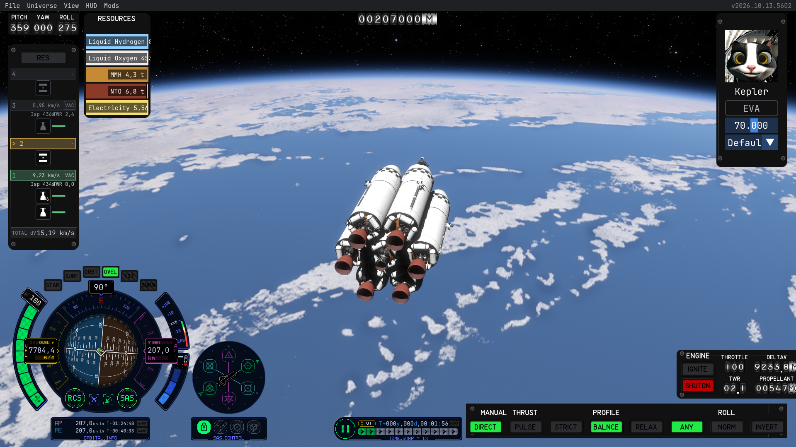
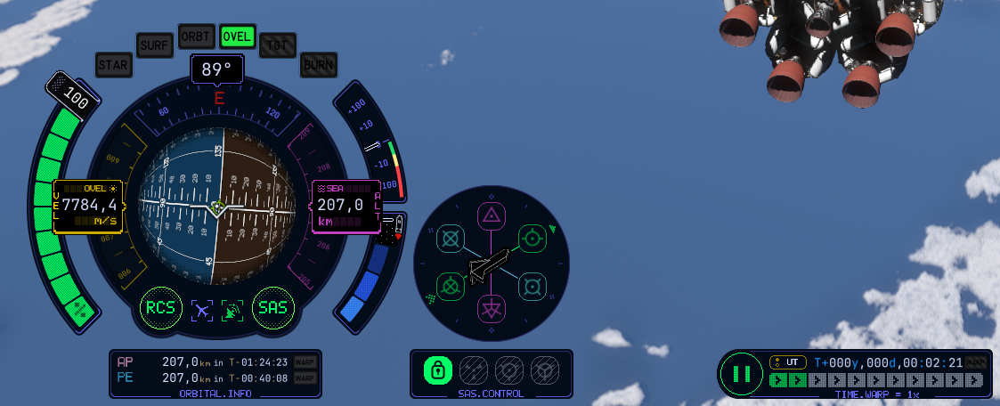
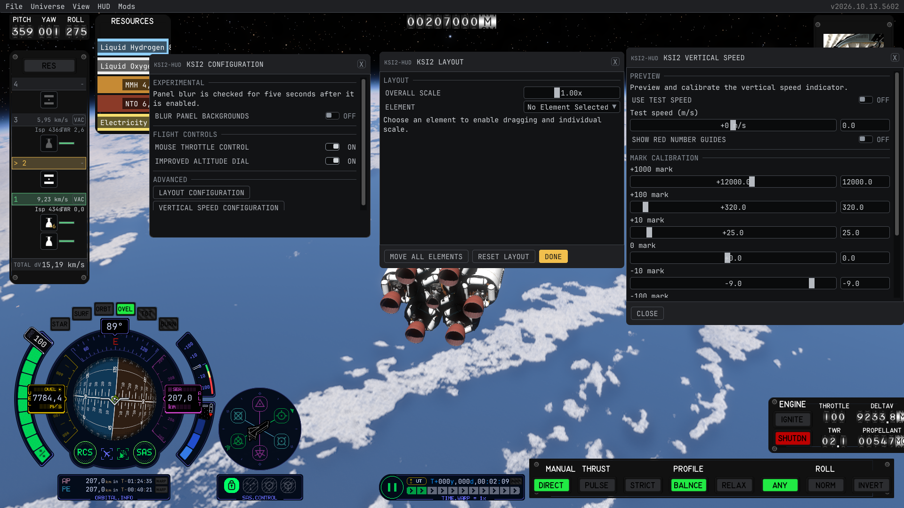
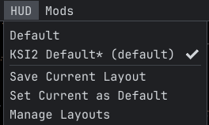

# KSI2

[](https://github.com/KittenSpaceInterface/KSI2/releases)
[](LICENSE)

KSI2 brings a KSP2-inspired flight interface to **Kitten Space Agency**, loaded
through [StarMap](https://github.com/StarMapLoader/StarMap). Follow your flight
with familiar instruments and arrange the HUD to suit your screen.

**Early development:** the current focus is the pilot interface. More of the
interface is still being built.



## Features

- **Flight instruments:** navball, heading, speed, altitude, throttle,
  atmospheric indicator, vertical speed, and apoapsis/periapsis readouts.
- **Flight controls:** switch speed reference modes, toggle RCS and SAS, and
  select supported SAS modes through KSA's flight controls.
- **Adjustable layout:** move, scale, and hide individual elements, or drag
  the HUD as a group. Each saved KSA HUD layout keeps its own KSI2 arrangement.
- **Optional settings:** mouse throttle control, an improved altitude dial,
  and experimental panel background blur.



## Installation

KSI2 requires **Kitten Space Agency** and
[**StarMap**](https://github.com/StarMapLoader/StarMap).
**ModMenu is optional** and provides access to KSI2's configuration window.

GitHub releases currently contain version history without packaged mod
binaries. [Build from source](#building-from-source) first, then install the
Release output:

1. Install StarMap following its setup instructions.
2. Create the `KSI2` folder in KSA's user mod directory:

   ```text
   Documents/My Games/Kitten Space Agency/mods/KSI2/
   ```

3. Copy the following from `src/KSI2/bin/Release/net10.0/` into that folder:

   ```text
   KSI2/
   ├── KSI2.dll
   ├── KSI2.deps.json
   ├── mod.toml
   ├── KSI2Assets.xml
   ├── ksi2.layout.defaults.json
   └── assets/                    (the complete folder)
   ```

4. Enable KSI2 in your user `manifest.toml` and launch KSA through StarMap.

When updating, preserve `ksi2.settings.json` and any personal
`ksi2.layout.json` beside the mod DLL.

## Configuration

With ModMenu installed, open **Mods > KSI2 > Configuration**. Without ModMenu,
KSI2 opens its settings window automatically at startup. Closing the window
leaves the flight instruments visible.

Use **Layout Configuration** to move, scale, and hide HUD elements. KSI2 hides
its flight HUD when KSA's built-in **Default** layout is selected. A newly
saved KSA layout inherits the KSI2 arrangement currently on screen.



| Setting | What it does |
| --- | --- |
| Mouse throttle control | Enables dragging the throttle handle through KSA's input actions. Experimental; off by default. |
| Improved altitude dial | Adjusts the dial's mark spacing for large distances. Off by default. |
| Blur panel backgrounds | Adds blur to the four flight panel backings, with adjustable opacity. Experimental. |
| Vertical Speed Configuration | Opens the calibration window under **Advanced**. Starts closed. |

Settings are saved beside the mod. For manual layout overrides, see the
[layout JSON guide](docs/pilot-layout-json.md).

### Switch back to KSA's HUD

On first launch, KSI2 creates **KSI2 Default** in KSA's HUD layouts and selects
it as the startup default. KSA loads that layout again on later launches.

To use KSA's original HUD, choose **HUD > Default**. To keep it on future
launches, leave **Default** selected and choose **HUD > Set Current as Default**.
You do not need to remove KSI2. If a later KSI2 update migrates its HUD layout,
it may select **KSI2 Default** again; repeat these steps if that happens.



<details>
<summary>Instrument behavior and advanced configuration</summary>

The throttle gauge follows the controlled vehicle's manual throttle. With
mouse throttle control enabled, dragging its handle changes throttle at KSA's
normal rate.

**Improved altitude dial** is off by default. When enabled, the right dial
uses 1 km between marks below 1 Mm (for example, `003`, `004`, `005` around
4 km), 1 Mm between marks from 1 Mm, and 1 Gm between marks from 1 Gm.
The scale continues in factors of 1,000 for larger distances, switching before
neighboring dial labels would exceed three digits. The dial
advances gradually between neighboring marks at each scale. When the option
is off, the dial keeps KSP2's 1 km mark spacing below 1 Gm; above that it
widens the spacing to keep the labels within three digits. The switch
is saved in `ksi2.settings.json`. The altitude card uses the same distance unit
order as KSA's apoapsis and periapsis readouts: mm, cm, m, km, Gm, AU, and ly.
It uses their six-cell unit cutoff, changing from km to Gm near 100,000 km.
The altitude card keeps ordinary numbers through 99,999.9 ly and uses compact
scientific notation above that, matching the AP/PE numeric limit.

The default instrument positions and draw order are in
`ksi2.layout.defaults.json`. To keep personal adjustments across installs,
place a sparse `ksi2.layout.json` beside the mod DLL; see
[`docs/pilot-layout-json.md`](docs/pilot-layout-json.md). KSI2 reads these files
when it starts. The in-game combined drag still saves its position in
`ksi2.settings.json`.

The **Experimental** setting **Blur panel backgrounds** covers the four flight
panel backings. Its switch and opacity are saved in `ksi2.settings.json`. After
enabling blur, KSI2 checks for five seconds that KSA stays open; if KSA exits
during that period, blur is turned off on the next launch. The same check runs
when KSI2 starts with blur enabled. A KSA version change also turns off blur
so it can be rechecked against the new version.

</details>

## Building from source

Building requires the **.NET 10 SDK** and the local KSA assemblies.
`Directory.Build.props` looks for assemblies in an `Import` directory one
level above the repository by default. To use your installed game, point
`KsaReferencePath` at the directory containing `KSA.dll` and `Brutal.*.dll`:

```powershell
dotnet restore KSI2.sln -p:KsaReferencePath="C:\path\to\Kitten Space Agency"
dotnet build KSI2.sln --configuration Release --no-restore -p:KsaReferencePath="C:\path\to\Kitten Space Agency"
```

If the default `Import` directory is already configured, omit the
`-p:KsaReferencePath=...` argument. Do not commit game assemblies.

The output is written to `src/KSI2/bin/Release/net10.0/`, including shaders,
optional libraries, and the LCD font. Use the complete `assets/` folder when
installing.

### Build and install helper

On Windows with Git Bash, `tools/build-install.sh` restores, builds Release,
runs the geometry checks, and installs the mod while preserving existing
settings. Set the paths for your machine before running it from the repository
root:

```bash
KSA_REFERENCE_PATH='C:/path/to/Kitten Space Agency' \
KSI2_MOD_DIR='C:/Users/your-name/Documents/My Games/Kitten Space Agency/mods/KSI2' \
bash tools/build-install.sh
```

### Geometry checks

Run the focused geometry, telemetry, and settings checks with:

```powershell
dotnet run --project tests/KSI2.GeometryTests --configuration Release
```

### Technical documentation

- [Pilot UI architecture](docs/pilot-ui-architecture.md)
- [Screen layout and navball placement](docs/screen-layout.md)
- [Layout JSON configuration](docs/pilot-layout-json.md)
- [Deferred UI work and experiments](docs/future-ui-plan.md)

### Releases

See [GitHub Releases](https://github.com/KittenSpaceInterface/KSI2/releases)
for version history.

<details>
<summary>Release workflow for contributors</summary>

`v0.0.1` is the baseline for automated releases. Earlier commits have no
historical release versions or changelog entries. Release Please reads
Conventional Commit messages on `main` since the previous release and uses
their descriptions to draft changelog entries. `feat:` proposes a minor
version, `fix:` proposes a patch version, and a breaking change before `1.0.0`
proposes a minor version. `docs:` and `chore:` commits alone do not propose a
release.

Release Please opens or updates one release pull request when eligible commits
reach `main`; more commits update that same proposal. Merging the release pull
request updates `version.txt` and `CHANGELOG.md` and creates the version tag
and GitHub Release. A mixed batch of features and fixes uses the minor version.
Reaching `1.0.0` requires an intentional release decision after the pilot
interface is complete. GitHub Releases created by this workflow do not include
mod binaries; follow the build and installation instructions above.

The workflow uses `GITHUB_TOKEN`. Repository and organization Actions settings
must allow GitHub Actions to create pull requests for the release PR to open.

</details>

## License

KSI2 is available under the [MIT License](LICENSE). It is an independent
community project and is not affiliated with or endorsed by the developers or
publishers of Kerbal Space Program 2 or Kitten Space Agency.
